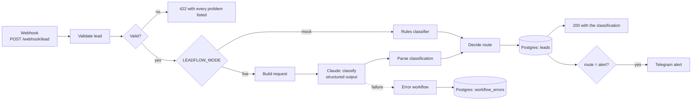

# leadflow

Inbound lead triage on self-hosted n8n. Every contact-form submission is validated,
classified by Claude into a strict JSON schema, routed (alert the team, draft a reply, or
archive), stored in Postgres with a full audit record, and answered over the same webhook
call. A separate error workflow records every failed run.

```
$ curl -s -X POST http://127.0.0.1:5678/webhook/lead -H 'Content-Type: application/json' \
    -d '{"name":"Maya Chen","email":"maya@brightcart.example",
         "message":"Hi! We need to migrate our Shopify store to a headless setup before
                    Black Friday. Budget is around $12k. Could you send a proposal this week?"}'
{
  "id": "7f031527-d744-4822-830b-cf46f16a8959",
  "category": "sales_inquiry",
  "urgency": "high",
  "budget_usd": 12000,
  "language": "en",
  "route": "alert",
  "summary": "Sales inquiry from Maya Chen: We need to migrate our Shopify store to a headless setup before Black Friday.",
  "draft_reply": "Hi Maya, thanks for getting in touch about your project. Could you share your timeline and the must-have features? We'll come back with next steps within one business day.\n\n— Northwind Studio team",
  "classifier": "rules"
}
```

*(Output from mock mode, which needs no API key. In live mode `classifier` is the model id
and the summary and draft are written by Claude.)*

## The workflow



| Step | What it does |
|---|---|
| **Validate lead** | Trims and length-limits every field, lower-cases e-mail, returns all problems at once (`422`) |
| **Claude: classify** | Messages API with `output_config.format` (JSON schema): the reply always parses. Retries 3×, low effort, server-side fallback if the model declines |
| **Rules classifier** | Deterministic stand-in for mock mode: same output shape, no API calls, no cost |
| **Decide route** | `spam → archive`, sales inquiry that is urgent or above `LEADFLOW_HIGH_VALUE_USD` → `alert`, everything else → `reply` (draft waits for a human) |
| **Save lead** | Parameterised `INSERT … RETURNING id` with the full classification kept as `jsonb` |
| **Telegram alert** | Optional ping for hot leads (`TELEGRAM_BOT_TOKEN`, `TELEGRAM_CHAT_ID`) |
| **Error workflow** | Error Trigger → `workflow_errors` (workflow, node, message, details) |

### Classification schema

| Field | Type | Values |
|---|---|---|
| `category` | enum | `sales_inquiry`, `support`, `partnership`, `job_application`, `spam`, `other` |
| `urgency` | enum | `high` (deadline within two weeks or budget ≥ 10k USD), `medium`, `low` |
| `budget_usd` | integer or null | Stated budget converted to USD |
| `language` | string | ISO 639-1 code of the message |
| `summary` | string | One English sentence for the team |
| `draft_reply` | string | First reply in the sender's language; empty for spam |

The prompt treats the submission as untrusted data: text inside `<lead>` is never followed
as instructions.

## Quick start

Requires Docker with Compose.

```bash
cp .env.example .env
# set POSTGRES_PASSWORD and N8N_ENCRYPTION_KEY, e.g. with `openssl rand -hex 24`
docker compose up -d --wait
python3 scripts/smoke_test.py --db
```

`docker compose up` starts Postgres, runs a one-shot bootstrap container that imports the
credentials and both workflows and publishes them, then starts n8n on
`http://127.0.0.1:5678`. Open it to see the workflow; the webhook works without logging in.

### Live mode (Claude)

```bash
# in .env
LEADFLOW_MODE=live
ANTHROPIC_API_KEY=sk-ant-...

docker compose up -d --wait --force-recreate n8n-bootstrap n8n
```

The API key is passed only to the bootstrap container, which stores it as an encrypted n8n
credential (`anthropic-api-key`); the long-running n8n container never has it in its
environment. The default model is `claude-opus-5-5` (`LEADFLOW_MODEL` overrides it).

## Configuration

| Variable | Default | Purpose |
|---|---|---|
| `POSTGRES_PASSWORD` | — | Database password (required) |
| `N8N_ENCRYPTION_KEY` | — | Encrypts n8n credentials (required; keep it stable) |
| `LEADFLOW_MODE` | `mock` | `mock` = rules classifier, `live` = Claude |
| `ANTHROPIC_API_KEY` | — | Needed in live mode |
| `LEADFLOW_MODEL` | `claude-opus-5-5` | Model for live mode |
| `LEADFLOW_COMPANY` | `Northwind Studio` | Company name used in prompts and draft replies |
| `LEADFLOW_HIGH_VALUE_USD` | `5000` | Budget at which a sales inquiry becomes an alert |
| `TELEGRAM_BOT_TOKEN`, `TELEGRAM_CHAT_ID` | — | Enable hot-lead alerts |

## Data model

`db/init/01-schema.sql` creates two tables in the `leadflow` database (n8n keeps its own
state in a separate `n8n` database on the same server):

- **leads**: one row per accepted submission: contact fields, classification, route,
  draft reply, which classifier ran, and the raw classification as `jsonb`. Check constraints
  keep `category`, `urgency` and `route` within their enums.
- **workflow_errors**: one row per failed execution, written by the error workflow.

```sql
SELECT route, count(*) FROM leads GROUP BY route;
SELECT occurred_at, node, message FROM workflow_errors ORDER BY id DESC LIMIT 10;
```

## Working on the workflow

The JavaScript of every Code node lives in `n8n/code/*.js`, where it can be read, linted and
unit-tested. `scripts/build_workflow.py` inlines it into `n8n/workflows/lead-intake.json`,
the file n8n imports.

```bash
node --test n8n/code/*.test.mjs            # unit tests for every Code node
python3 scripts/build_workflow.py          # regenerate the workflow after an edit
python3 scripts/build_workflow.py --check  # CI: fail if the export is stale
docker compose up -d --wait --force-recreate n8n-bootstrap n8n
python3 scripts/smoke_test.py --db         # end-to-end against the running stack
```

The unit tests run each Code node's source the way n8n does (as a function body with `$json`,
`$env` and `$()` in scope) against the sample leads in `samples/leads.json`. The smoke test
posts the same samples to the live webhook and checks status codes, categories, routes and the
rows written to Postgres. CI runs both, the latter against a fresh `docker compose` stack.

## License

[MIT](LICENSE)
